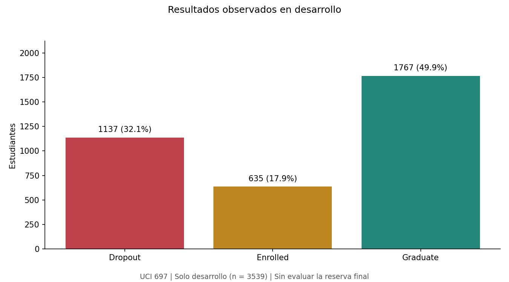
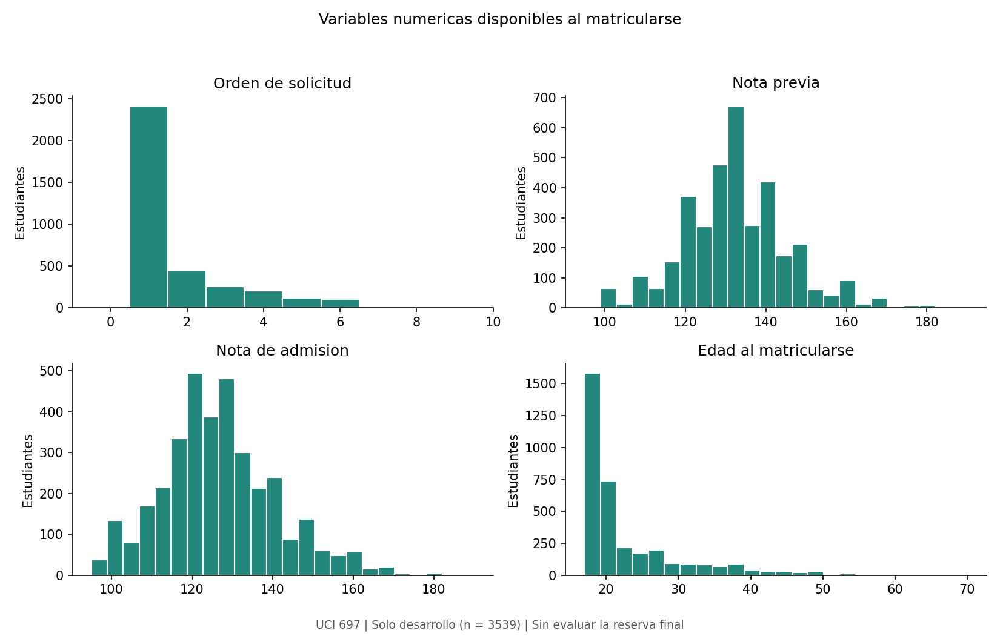
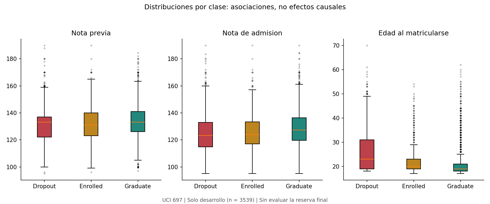
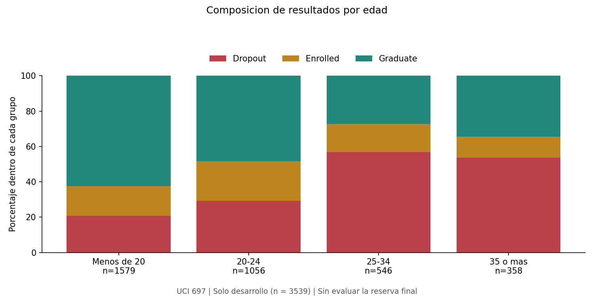
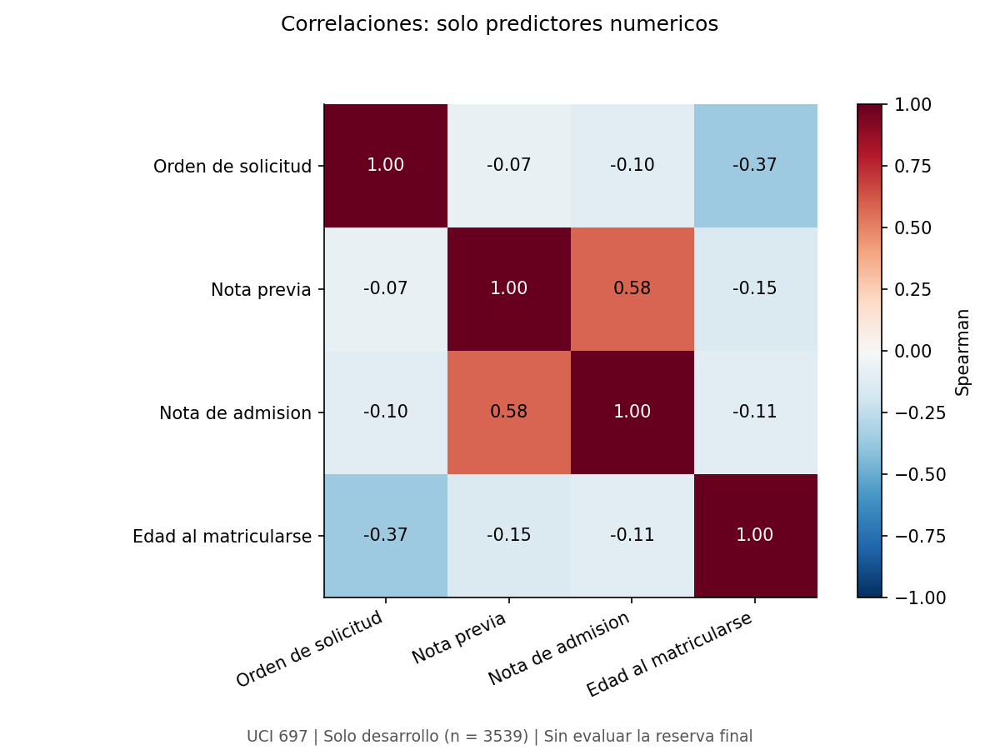
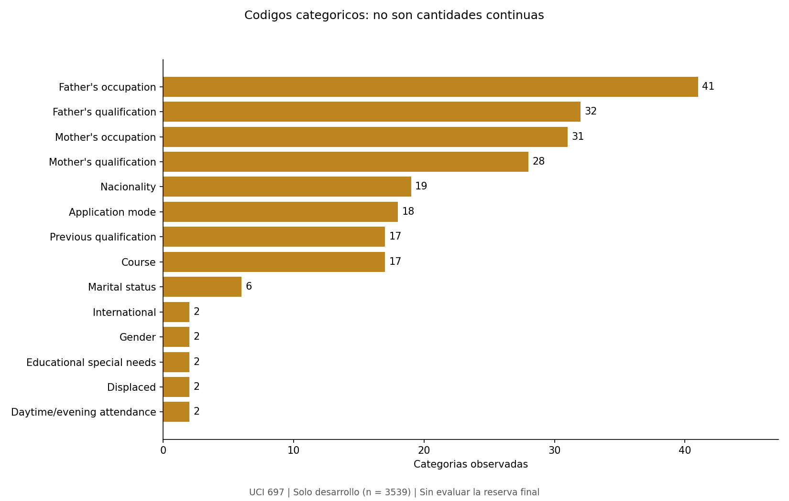
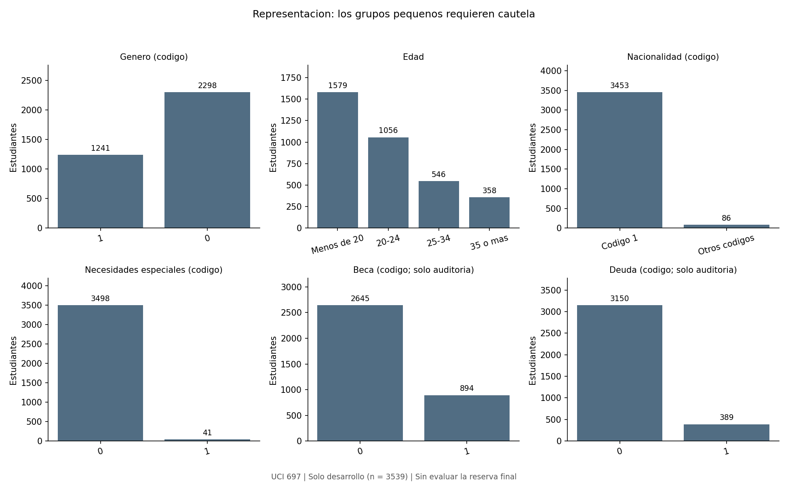

# Analisis exploratorio de datos

## Alcance y procedencia

Este analisis utiliza exclusivamente las **3539 filas de desarrollo** del dataset
UCI 697. Las 885 filas de reserva no se utilizan para explorar variables,
seleccionar modelos ni medir su rendimiento. Se conserva el manifiesto original
y sus cinco folds de 708, 708, 708, 708 y 707 filas.

La fuente contiene 36 predictores y Target; el contrato de modelado conserva
18 variables de matricula. [Fuente, licencia CC BY 4.0 y atribucion](../data/README.md).
Las categorias y sus codigos se interpretan con el diccionario oficial, no como
escalas numericas. El indice de fila sirve para trazabilidad, nunca como predictor.

Este documento y sus graficos se generan con `python -m src.eda`.
La evidencia completa esta en [eda.json](../results/metrics/eda.json);
la integridad se comprueba mediante [data_audit.json](../results/metrics/data_audit.json).
Los valores redondeados son descriptivos, no resultados de modelos.

## Calidad y disponibilidad temporal

- Celdas nulas en desarrollo: 0.
- Filas exactamente duplicadas: 0.
- Filas repetidas en las 18 variables predictoras: 0.
- Incumplimientos de los controles de rango implementados: 0.

Los controles verifican notas entre 0 y 200, orden de solicitud entre 0 y 9,
edad positiva y algunos indicadores binarios. No sustituyen una validacion
completa del diccionario ni descartan errores de captura. No tener valores nulos
tampoco garantiza que todos los codigos sean informativos: existen categorias
que representan informacion desconocida.

Se excluyen los 12 indicadores de rendimiento semestral por ser posteriores al
momento de prediccion. Tambien se excluyen deuda, pagos al dia, beca y los tres
indicadores economicos por no haber confirmado su temporalidad al matricularse.
Beca y deuda se describen solo para auditoria retrospectiva, no como predictores.
Las columnas adicionales del frame no deben introducirse automaticamente al modelo.

## Clases y desbalance

| Clase | Estudiantes | Porcentaje |
|---|---:|---:|
| Dropout | 1137 | 32.13% |
| Enrolled | 635 | 17.94% |
| Graduate | 1767 | 49.93% |

Graduate es la clase mayoritaria. Enrolled expresa permanencia al corte, no
graduacion ni abandono confirmado. La comparacion futura usara F1 macro y
metricas por clase; accuracy por si sola podria ocultar errores en las clases
menos frecuentes. La cobertura de abandono en el 20% priorizado responde a un
supuesto de capacidad de apoyo, no a una capacidad institucional ya validada.

No se aplica sobremuestreo ni balanceo al conjunto completo. Cualquier
tratamiento del desbalance se ajustara exclusivamente dentro del entrenamiento.

## Variables numericas y valores atipicos

| Variable | Media | Mediana | Minimo | Maximo | Fuera de 1,5 IQR |
|---|---:|---:|---:|---:|---:|
| Application order | 1.73 | 1.00 | 0.00 | 9.00 | 431 |
| Previous qualification (grade) | 132.68 | 133.10 | 95.00 | 190.00 | 135 |
| Admission grade | 126.88 | 126.00 | 95.00 | 190.00 | 68 |
| Age at enrollment | 23.25 | 20.00 | 17.00 | 70.00 | 358 |

La regla IQR senala observaciones para revisar; no prueba que sean errores.
No se eliminaron estudiantes de mayor edad ni se recortaron notas. El orden de
solicitud es discreto: una bandera IQR no implica una solicitud invalida.
Imputacion, escalado o limites aprendidos se ajustaran dentro de cada fold,
nunca usando toda la validacion o la reserva.

Las cajas por clase muestran solapamiento de distribuciones: diferencias entre
grupos no equivalen a separacion individual perfecta. Son asociaciones
observacionales, no evidencia de que modificar una nota o una edad cambie
causalmente el resultado.

## Correlaciones

Se calcula Spearman exclusivamente entre las cuatro variables numericas.
La correlacion entre nota previa y nota de admision es **0.583**.
Esta relacion no justifica por si sola eliminar una variable: su utilidad se
evaluara con validacion. No se correlacionan codigos nominales de carreras,
nacionalidades u ocupaciones como si fueran cantidades.

## Variables categoricas

| Predictor | Categorias | Categorias con menos de 10 casos | Filas en esas categorias |
|---|---:|---:|---:|
| Marital status | 6 | 2 | 7 |
| Application mode | 18 | 4 | 6 |
| Course | 17 | 0 | 0 |
| Daytime/evening attendance | 2 | 0 | 0 |
| Previous qualification | 17 | 8 | 34 |
| Nacionality | 19 | 14 | 25 |
| Mother's qualification | 28 | 18 | 52 |
| Father's qualification | 32 | 21 | 54 |
| Mother's occupation | 31 | 18 | 54 |
| Father's occupation | 41 | 27 | 60 |
| Displaced | 2 | 0 | 0 |
| Educational special needs | 2 | 0 | 0 |
| Gender | 2 | 0 | 0 |
| International | 2 | 0 | 0 |

El umbral de 10 se usa solo como descripcion de escasez, no como regla de
agrupacion seleccionada. Categorias poco frecuentes pueden generar estimaciones
inestables. Se mantendra codificacion nominal con manejo de categorias no vistas;
cualquier agrupacion debera evaluarse dentro de entrenamiento. El EDA no revierte
la evidencia previa de que agrupar categorias no mejoro el F1 de la regresion.

## Representacion y futura auditoria de equidad

Los intervalos de edad se fijan como menos de 20, 20-24, 25-34 y 35 o mas anos.
Son intervalos descriptivos, no umbrales de elegibilidad para recibir apoyo.

| Dimension | Grupo/codigo | Estudiantes |
|---|---|---:|
| Genero (codigo) | 1 | 1241 |
| Genero (codigo) | 0 | 2298 |
| Edad | Menos de 20 | 1579 |
| Edad | 20-24 | 1056 |
| Edad | 25-34 | 546 |
| Edad | 35 o mas | 358 |
| Nacionalidad (codigo) | 1 | 3453 |
| Nacionalidad (codigo) | 26 | 12 |
| Nacionalidad (codigo) | 22 | 10 |
| Nacionalidad (codigo) | 41 | 26 |
| Nacionalidad (codigo) | 6 | 13 |
| Nacionalidad (codigo) | 21 | 2 |
| Nacionalidad (codigo) | 24 | 3 |
| Nacionalidad (codigo) | 62 | 2 |
| Nacionalidad (codigo) | 11 | 3 |
| Nacionalidad (codigo) | 103 | 2 |
| Nacionalidad (codigo) | 105 | 2 |
| Nacionalidad (codigo) | 101 | 2 |
| Nacionalidad (codigo) | 100 | 3 |
| Nacionalidad (codigo) | 32 | 1 |
| Nacionalidad (codigo) | 14 | 1 |
| Nacionalidad (codigo) | 25 | 1 |
| Nacionalidad (codigo) | 13 | 1 |
| Nacionalidad (codigo) | 108 | 1 |
| Nacionalidad (codigo) | 2 | 1 |
| Necesidades especiales (codigo) | 0 | 3498 |
| Necesidades especiales (codigo) | 1 | 41 |
| Beca (codigo; solo auditoria) | 0 | 2645 |
| Beca (codigo; solo auditoria) | 1 | 894 |
| Deuda (codigo; solo auditoria) | 0 | 3150 |
| Deuda (codigo; solo auditoria) | 1 | 389 |

La figura de nacionalidad agrupa codigo 1 y otros codigos unicamente para
legibilidad; la tabla y el JSON conservan todos los grupos. Las diferencias de
tamano y la composicion por edad no son metricas de discriminacion del modelo.
Todavia faltan tasas de seleccion, cobertura y falsos positivos por subgrupo,
con conteos e intervalos de Wilson calculados sobre predicciones de validacion.
Los grupos pequenos no permiten conclusiones fuertes sobre equidad.

## Visualizaciones

### Figura 1: Distribucion de las clases

### Figura 2: Distribuciones de las variables numericas

### Figura 3: Notas y edad por resultado

### Figura 4: Composicion de resultados por edad

### Figura 5: Correlaciones entre variables numericas

### Figura 6: Cardinalidad de predictores categoricos

### Figura 7: Representacion de subgrupos

## Decisiones y limitaciones

Se mantienen las particiones historicas, las 18 variables y las observaciones
sin borrados automaticos. El preprocesamiento estadistico se ajustara dentro
de cada entrenamiento. Los graficos orientan hipotesis y controles, pero no
demuestran rendimiento, equidad, causalidad ni generalizacion local.

El origen institucional portugues y las categorias administrativas limitan la
transferencia directa a Ecuador. No existe aqui validacion temporal ni externa.
La reserva sigue sin evaluacion; el analisis de errores, la auditoria del modelo,
las pruebas de estres y la evaluacion final se documentaran en fases posteriores.

## Referencia

Realinho, V., Vieira Martins, M., Machado, J., & Baptista, L. (2021).
Predict Students' Dropout and Academic Success [Dataset]. UCI Machine Learning
Repository. https://doi.org/10.24432/C5MC89
