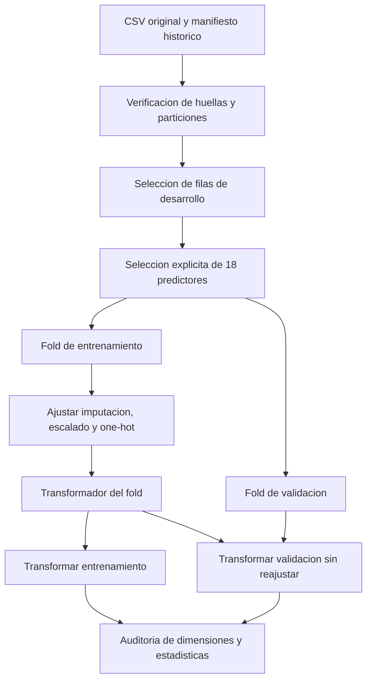
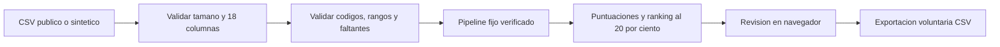

# Arquitectura del sistema

Carga, preprocesamiento, modelos base y optimizacion anidada implementados y auditados.
El clasificador seleccionado es LR_base; su pipeline entrenado esta en
`models/student_support_v1.joblib`. La aplicacion local se integra mediante Flask.

## Flujo de desarrollo implementado

La reserva de 885 filas queda fuera de este flujo. El cargador lee el CSV publico
para verificar el manifiesto, pero solo devuelve las 3.539 filas de desarrollo.
No es un control de acceso fisico al archivo: es una separacion metodologica.

## Contrato y transformaciones

`select_predictors` exige un DataFrame no vacio, nombres de columna unicos,
las 18 variables requeridas, almacenamiento numerico y ausencia de infinitos.
Mantiene los nulos y el orden de filas. Descarta columnas adicionales, incluidos
Target, indicadores semestrales y variables reservadas para auditoria.

Los codigos nominales se conservan como numeros al cargar, pero se tratan como
categorias. Esta validacion no comprueba todos los codigos o rangos del dominio;
la interfaz las aplica mediante src/inference.py antes de la inferencia.

| Rama | Variables | Imputacion | Transformacion |
|---|---|---|---|
| Numerica | Orden de solicitud, nota previa, nota de admision, edad | Mediana del entrenamiento | StandardScaler, media y varianza del entrenamiento |
| Categorica | Las otras 14 variables de la lista explicita | Moda del entrenamiento | OneHotEncoder, categorias aprendidas del entrenamiento |

`build_preprocessor` devuelve un ColumnTransformer sin ajustar. Usa
`handle_unknown='ignore'`, `sparse_output=False`, `min_frequency=None` y
`remainder='drop'`. Una categoria no vista genera ceros en su bloque; esto evita
una excepcion pero no prueba que el modelo sea valido para esa categoria.

Cada fold ejecuta fit_transform solo en entrenamiento y transform en validacion.
La imputacion conserva el esquema historico aunque no haya nulos en desarrollo.
No se agrupan categorias ni se eliminan atipicos en este paso. Si una variable
estuviera completamente ausente en entrenamiento, haria falta definir un
tratamiento especifico antes de aceptar ese escenario; no ocurre en los folds
actuales y no se afirma haberlo resuelto.

## Evidencia verificable

Ejecutar `python -m src.preprocessing_audit`. La evidencia completa esta en
[preprocessing_audit.json](../results/metrics/preprocessing_audit.json), y el
procedimiento se demuestra en [el notebook ejecutado](../notebooks/02_preprocesamiento.ipynb).

| Fold | Entrenamiento | Validacion | Columnas codificadas |
|---|---:|---:|---:|
| 1 | 2831 | 708 | 213 |
| 2 | 2831 | 708 | 217 |
| 3 | 2831 | 708 | 214 |
| 4 | 2831 | 708 | 211 |
| 5 | 2832 | 707 | 210 |

Las dimensiones varian porque las categorias observadas en entrenamiento son
distintas; dentro de cada fold coinciden para entrenamiento y validacion.
La auditoria compara medianas, medias, varianzas, modas y categorias aprendidas
con sus calculos directos sobre entrenamiento, y verifica que transformar
validacion no altera ese estado. Se registran categorias de validacion no vistas.

Las pruebas automatizadas incluyen entradas invalidas, faltantes sinteticos,
categorias nuevas, clonacion independiente y ausencia de reajuste con valores
extremos en validacion. No son pruebas de rendimiento de clasificadores.

## Integracion del entrenamiento

Los modelos base ya se integran con el preprocesamiento en un Pipeline en
`src/model.py`. El entrenamiento por folds se ejecuta mediante `src/train.py`.
El calculo de metricas se centraliza en `src/evaluate.py`; `src/verify.py`
recalcula las metricas de validacion desde las predicciones guardadas.

## Modelos base implementados

| Modelo | Configuracion de referencia | Funcion |
|---|---|---|
| Dummy prior | Frecuencias de clase del entrenamiento | Comparacion sin capacidad discriminativa |
| Regresion logistica | C=1, balanced, max_iter=3000, semilla 42 | Referencia lineal |
| Random Forest | 200 arboles, min_samples_leaf=3, max_depth=None, max_features=sqrt, balanced, semilla 42 | Referencia no lineal |

Los parametros completos se registran por fold. Se conservan las configuraciones
historicas; no se optimizan ni se seleccionan usando la reserva.
Las probabilidades de salida siguen el orden Dropout, Enrolled, Graduate.
Son puntuaciones del modelo, no riesgos calibrados demostrados.

El [reporte de modelos base](../results/reports/baseline_report.md) contiene
metricas, graficos, definiciones, diagnostico y limitaciones. Los resultados
principales son medias de folds; las matrices de confusion usan OOF agrupadas.
No deben confundirse esas dos formas de agregacion.

El diagnostico oriento dos experimentos: limitar profundidad y hoja minima de
RF, y expandir las cuatro variables numericas de LR a 14 terminos de grado 2.
La expansion se aplica despues de imputar y antes de escalar, sin multiplicar
codigos categoricos. Las dimensiones anteriores corresponden al esquema base.

`src/optimize.py` selecciona parametros con tres folds internos por cada uno
de los cinco folds externos. Cada ajuste vuelve a aprender el pipeline solo
con entrenamiento interno. Su funcion `verify()` audita seleccion, particiones
y metricas externas desde predicciones guardadas. El [protocolo y los resultados](optimizacion.md)
incluyen sensibilidad descriptiva de hiperparametros. No hay modelo definitivo
guardado por esos experimentos. La seleccion posterior y su artefacto se
documentan en [la decision final](seleccion_modelo.md).

## Integracion del artefacto final

La evaluacion del artefacto fijo se implementa en `src/final_evaluation.py`.
Utiliza la reserva historica sin reajustar el pipeline. Conserva predicciones
y recalcula metricas desde esos archivos en ejecuciones posteriores.
Los resultados se presentan en [evaluacion final](evaluacion_final.md).

El clasificador y su transformador se conservaron en un Pipeline: cada ajuste
interno aprendio el preprocesamiento solo con su entrenamiento. No se hizo
validacion cruzada sobre matrices ajustadas con todo desarrollo. El artefacto
definitivo se entreno despues de fijar modelo y protocolo; la reserva se
evaluo sin reajustar con ella.

Las versiones verificadas se fijan en [requirements.txt](../requirements.txt).
La persistencia se implementa en `src/finalize.py`: entrena exclusivamente en
desarrollo y rechaza sobrescribir el artefacto existente. Los metadatos registran
huellas, versiones e indices de entrenamiento. El pipeline acepta los 18
predictores y devuelve clases o puntuaciones en el orden registrado.
`load_frozen()` comprueba huella, configuracion y version de scikit-learn.
Solo se deben deserializar artefactos de confianza.

## Aplicacion local

`app/app.py` sirve HTML, CSS, JavaScript e iconos locales; expone las rutas de
muestra, contrato de columnas, evidencia y analisis CSV. `src/inference.py`
centraliza lectura, validacion, inferencia y ranking estable. Ninguna ruta
entrena modelos ni modifica la evidencia de evaluacion.

En modo local el proceso solo escucha en 127.0.0.1. Se limita el CSV a 200 KB y 1.000 filas;
se procesan cargas en memoria sin guardarlas como archivos del servidor.
El esquema rechaza columnas extra, incluidas Target e identificadores; requiere
al menos cinco registros. No se permiten categorias desconocidas ni filas con
mas del 20% de celdas vacias. Los umbrales de admision son controles de interfaz,
no nuevos hiperparametros ni una garantia de rendimiento bajo ese umbral.

El ranking usa puntuacion Dropout, cupo ceil(0,20*n) y desempate por orden del
archivo. Las filas se identifican con codigos locales de posicion. La exportacion
incluye todo el lote ordenado, no las entradas originales. El navegador mantiene
resultados solo durante la sesion de pagina; no hay persistencia de revisiones,
autenticacion institucional ni contacto automatico con estudiantes.

El modelo se carga desde un artefacto confiable y se comprueba su huella antes
de cada inferencia. El servidor aplica limite de peticion, Host permitido,
control de origen, CSP y cabeceras de seguridad. Estos controles son para una
demostracion academica, no sustituyen una evaluacion de seguridad institucional.
El [manual](manual_usuario.md) documenta las pantallas y el contrato completo.

## Ejecucion remota

Render ejecuta app.wsgi con Gunicorn, un worker y dos threads, en el puerto
asignado por PORT. El proveedor termina HTTPS; app/deployment.py admite solo
el hostname asignado y verifica el origen publico. /health comprueba la
integridad del artefacto. No hay entrenamiento al arrancar ni persistencia de
lotes. El modelo y el preprocesamiento son los mismos que en modo local.
Consultar [configuracion, limites y pruebas](despliegue.md).
