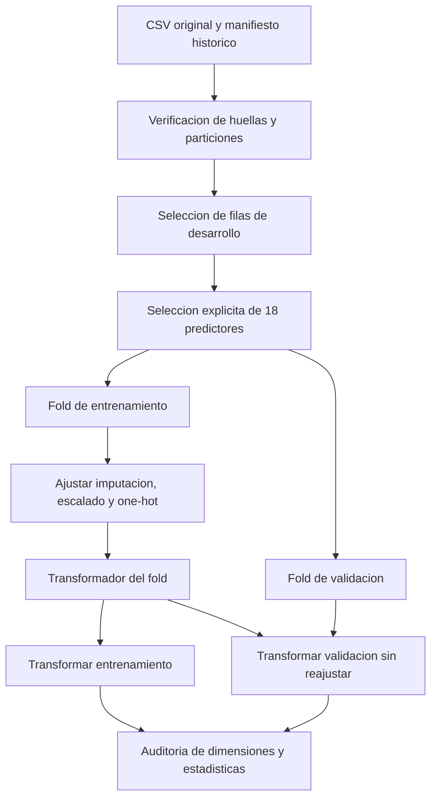

# Arquitectura del sistema

Estado: carga, seleccion y preprocesamiento implementados y auditados. El
clasificador final, la aplicacion y su integracion estan pendientes.

## Flujo de desarrollo implementado

La reserva de 885 filas queda fuera de este flujo. El cargador lee el CSV publico
para verificar el manifiesto, pero solo devuelve las 3.539 filas de desarrollo.
No es un control de acceso fisico al archivo: es una separacion metodologica.

## Contrato y transformaciones

`select_predictors` exige un DataFrame no vacio, nombres de columna unicos,
las 18 variables requeridas, almacenamiento numerico y ausencia de infinitos.
Mantiene los nulos y el orden de filas. Descarta columnas adicionales, incluidos
Target, indicadores semestrales y variables reservadas para auditoria.

Los codigos nominales se conservan como numeros al cargar, pero se tratan como
categorias. Esta validacion no comprueba todos los codigos o rangos del dominio;
esas validaciones deberan completarse en la interfaz.

| Rama | Variables | Imputacion | Transformacion |
|---|---|---|---|
| Numerica | Orden de solicitud, nota previa, nota de admision, edad | Mediana del entrenamiento | StandardScaler, media y varianza del entrenamiento |
| Categorica | Las otras 14 variables de la lista explicita | Moda del entrenamiento | OneHotEncoder, categorias aprendidas del entrenamiento |

`build_preprocessor` devuelve un ColumnTransformer sin ajustar. Usa
`handle_unknown='ignore'`, `sparse_output=False`, `min_frequency=None` y
`remainder='drop'`. Una categoria no vista genera ceros en su bloque; esto evita
una excepcion pero no prueba que el modelo sea valido para esa categoria.

Cada fold ejecuta fit_transform solo en entrenamiento y transform en validacion.
La imputacion conserva el esquema historico aunque no haya nulos en desarrollo.
No se agrupan categorias ni se eliminan atipicos en este paso. Si una variable
estuviera completamente ausente en entrenamiento, haria falta definir un
tratamiento especifico antes de aceptar ese escenario; no ocurre en los folds
actuales y no se afirma haberlo resuelto.

## Evidencia verificable

Ejecutar `python -m src.preprocessing_audit`. La evidencia completa esta en
[preprocessing_audit.json](../results/metrics/preprocessing_audit.json), y el
procedimiento se demuestra en [el notebook ejecutado](../notebooks/02_preprocesamiento.ipynb).

| Fold | Entrenamiento | Validacion | Columnas codificadas |
|---|---:|---:|---:|
| 1 | 2831 | 708 | 213 |
| 2 | 2831 | 708 | 217 |
| 3 | 2831 | 708 | 214 |
| 4 | 2831 | 708 | 211 |
| 5 | 2832 | 707 | 210 |

Las dimensiones varian porque las categorias observadas en entrenamiento son
distintas; dentro de cada fold coinciden para entrenamiento y validacion.
La auditoria compara medianas, medias, varianzas, modas y categorias aprendidas
con sus calculos directos sobre entrenamiento, y verifica que transformar
validacion no altera ese estado. Se registran categorias de validacion no vistas.

Las pruebas automatizadas incluyen entradas invalidas, faltantes sinteticos,
categorias nuevas, clonacion independiente y ausencia de reajuste con valores
extremos en validacion. No son pruebas de rendimiento de clasificadores.

## Integracion prevista

El clasificador y este transformador se integraran en un mismo Pipeline para
que cada ajuste interno de hiperparametros vuelva a aprender el preprocesamiento
solo con su entrenamiento. No se hara validacion cruzada sobre matrices ajustadas
con todo desarrollo. El entrenamiento definitivo se realizara despues de fijar
el modelo y protocolo, y la reserva se evaluara sin reajustar con ella.

Las versiones verificadas se fijan en [requirements.txt](../requirements.txt).
La arquitectura completa, justificacion del clasificador final, persistencia,
contrato de salida e interfaz se documentaran al implementarse. No se ha
seleccionado aun un modelo final en este repositorio.
