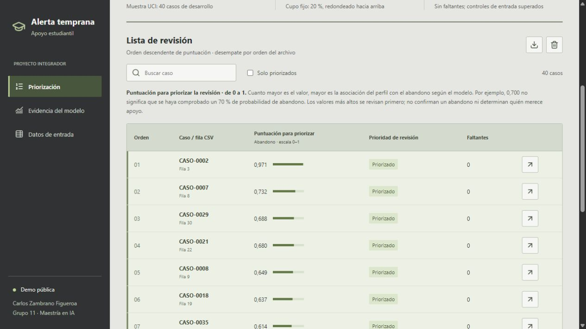

# Despliegue de la demostracion en Render

La indicacion docente del 22/10/2026 exige ejecucion remota. Este despliegue
amplia el alcance de la demo local, no convierte el sistema en un servicio
institucional ni cambia el modelo.

**Aplicacion publica:** https://alerta-temprana-abandono-estudiantil.onrender.com

Despliegue verificado el 22/10/2026, sin autenticacion de visitante, en Oregon,
plan Free ($0/mes, 512 MB). Render resolvio Python 3.11.17. El despliegue inicial
utiliza el commit a02bf75084073b5a492256e18eb28ca0f4999e9e.

## Configuracion reproducible

- Servicio web Python, repositorio publico, rama main y plan Free.
- Python 3.11: Render resuelve la revision desde .python-version.
- Build: pip install -r requirements-render.txt.
- Start: gunicorn app.wsgi:app --bind 0.0.0.0:$PORT --workers 1 --threads 2 --timeout 120 --access-logfile -.
- Health check: /health.
- OMP_NUM_THREADS, OPENBLAS_NUM_THREADS y MKL_NUM_THREADS: 1.
- Sin base de datos, disco persistente, tareas de entrenamiento ni tarjeta.

render.yaml conserva la configuracion equivalente para Blueprint. La
creacion manual debe usar los mismos comandos. app.wsgi carga el artefacto
existente; /health comprueba su huella. No se ejecutan src.train, src.optimize
ni una nueva evaluacion final durante el despliegue.

El proveedor entrega RENDER_EXTERNAL_HOSTNAME. La app acepta ese dominio
exacto y exige el origen HTTPS correspondiente para solicitudes del navegador.
No se confia en X-Forwarded-Host ni se permite cualquier dominio onrender.com.
La ejecucion local conserva su host 127.0.0.1 y sus controles.

## Datos, privacidad y limites

Al utilizar la URL publica, los datos del CSV se transmiten a infraestructura
de Render. Solo deben usarse ejemplos publicos o sinteticos, nunca expedientes
reales de estudiantes. El proceso no persiste el CSV; la plataforma puede
registrar metadatos de acceso como IP, ruta, hora y estado HTTP. La ausencia
de almacenamiento de lotes no significa ausencia absoluta de registros.

No hay autenticacion ni canales de derechos institucionales. Se mantienen
los limites de 200 KB, 1.000 filas, categorias y faltantes. El plan gratuito
tiene recursos limitados; los controles no son una proteccion completa contra
abuso o denegacion de servicio. No utilizar como infraestructura critica.

Los servicios gratuitos pueden suspenderse tras 15 minutos de inactividad;
la siguiente visita los reactiva y puede tardar alrededor de un minuto.
No se configuran solicitudes artificiales para evitar esa suspension.

## Verificacion realizada

El [registro remoto](../results/metrics/cloud_verification.json) confirma
salud correcta, 40 casos y ocho priorizados, concordancia de las predicciones
con el artefacto local y coincidencia de las metricas publicadas.
La API acepta el CSV valido y el caso con una nota ausente (HTTP 200),
rechaza la categoria invalida (400) y un origen ajeno (403).
Se revisaron en el navegador el ranking y el detalle individual.
Estas comprobaciones no son una nueva evaluacion predictiva ni un ensayo de carga.



Para repetir la verificacion funcional desde la raiz:

```text
python -m src.verify_cloud https://alerta-temprana-abandono-estudiantil.onrender.com
```

## Comprobacion antes de compartir

Abrir el enlace HTTPS sin sesion de Render; comprobar /health, 40 casos y
ocho priorizados en la muestra; cargar el lote valido, el caso con nota
vacia y el codigo invalido. Revisar detalle, exportacion, recursos y metricas
de prueba. Comparar la huella devuelta por /api/demo con la registrada.
El estado de build por si solo no confirma que el flujo de usuario funcione.

## Mantenimiento

Una modificacion del codigo puede activar otro despliegue segun la
configuracion del servicio. Revisar los logs antes de compartir cambios.
Mantener el plan Free; no activar recursos de pago ni proporcionar datos
privados para probar. Los cambios del modelo requieren un protocolo nuevo
y evaluacion independiente, no ajustes sobre la reserva final usada.

Fuentes: [Flask en Render](https://render.com/docs/deploy-flask),
[limites gratuitos](https://render.com/docs/free),
[version de Python](https://render.com/docs/python-version).
