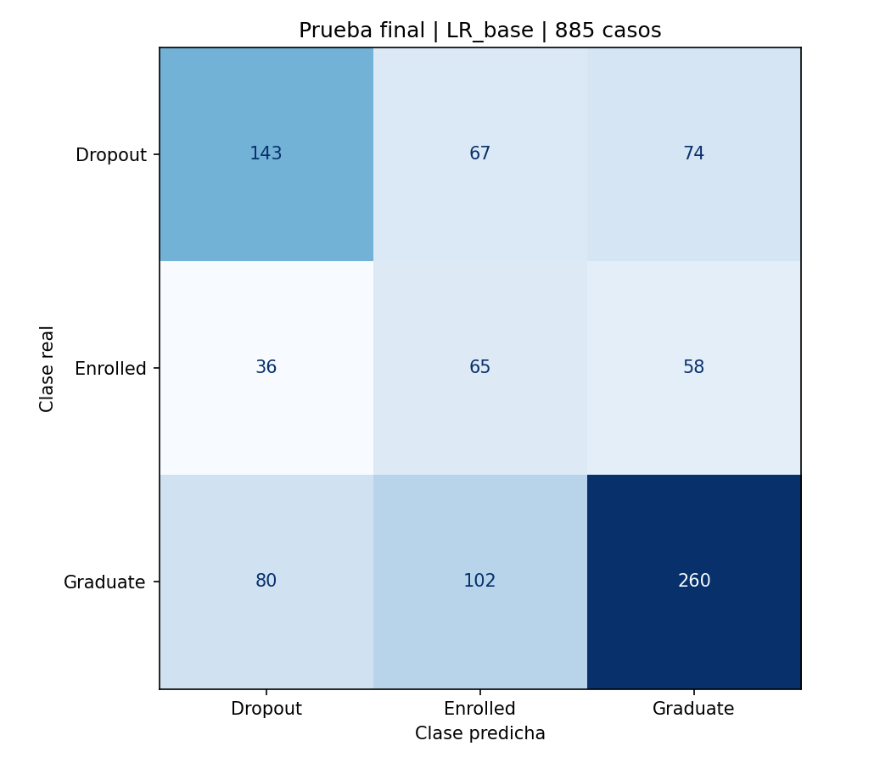

# Evaluacion final del modelo seleccionado

## Resultado principal

El F1 macro sobre **885 casos de prueba** es
**0.49366**. La meta previamente fijada de 0,60 queda
**no alcanzada**. Se evalua exclusivamente LR_base entrenada con 3.539 casos
de desarrollo; no se reentrena ni se elige otro candidato con esta prueba.

## Separacion entre validacion y prueba

| Indicador | Validacion: media de 5 folds | Prueba final: 885 casos |
|---|---:|---:|
| F1 macro | 0.51584 | 0.49366 |
| Accuracy | 0.54958 | 0.52881 |
| Cobertura al 20% | 39.75% | 40.14% |

La validacion historica usa cinco modelos ajustados por fold; la prueba usa
un solo artefacto ajustado con todo desarrollo. Son estimaciones diferentes,
no correcciones de los resultados anteriores. F1 macro no es porcentaje de
aciertos. Log-loss en prueba: 0.98373; reportarlo no demuestra
calibracion. Las puntuaciones se usan para ordenar, no como certezas personales.

## Rendimiento por clase

| Clase | Precision | Recall | F1 | Casos |
|---|---:|---:|---:|---:|
| Dropout | 0.55212 | 0.50352 | 0.52670 | 284 |
| Enrolled | 0.27778 | 0.40881 | 0.33079 | 159 |
| Graduate | 0.66327 | 0.58824 | 0.62350 | 442 |

Enrolled significa matriculado al corte del dataset, no graduacion futura
confirmada. La matriz usa filas reales y columnas predichas, en el orden
Dropout, Enrolled, Graduate.

## Priorizacion con cupo del 20%

Se seleccionan **177** estudiantes y se incluyen
**114 de 284 abandonos**:
cobertura **40.14%**. Quedan fuera
170 abandonos. Entre los seleccionados,
63 no tienen abandono registrado al corte; este conteo
es un error del ranking respecto a esa etiqueta, no el falso positivo multiclase
ni evidencia de que el apoyo sea innecesario.

Una seleccion uniforme aleatoria del mismo cupo cubriria en esperanza el
20.00% de los abandonos,
56.80 casos. La cobertura observada es
2.01 veces esa referencia.
No es una prueba de significacion ni demuestra reduccion causal del abandono.

## Trazabilidad y limites

La [decision y protocolo](seleccion_modelo.md) se fijaron antes de la evaluacion.
El modelo conserva su huella SHA-256: `028b9d7071eaa9549b2cfb64f177f34d2aaf5aeb645eb1f7b4af63b746d8c5f1`.
Se guardaron las predicciones, etiquetas, seleccion y metricas; el verificador
recalcula las cifras sin volver a entrenar ni seleccionar configuraciones.
La reserva ya fue utilizada para esta prueba y no debe reutilizarse para ajustar
el modelo. Una mejora futura requerira una evaluacion independiente adecuada.

La evaluacion corresponde a una particion aleatoria del dataset institucional
portugues. No demuestra validez temporal, transferibilidad a Ecuador, equidad
ni eficacia de una intervencion. La [auditoria por subgrupos](../results/reports/fairness_report.md)
y las [pruebas de robustez](robustez.md) describen validacion de desarrollo,
no pruebas por subgrupo del artefacto final. No deben presentarse como tales.

## Reproduccion

`python -m src.final_evaluation` evalua solo si no existen archivos finales.
Si ya existen, verifica sus predicciones guardadas y reconstruye el informe;
no repite una busqueda ni sustituye resultados.

- [Metricas finales](../results/metrics/final_test_results.json)
- [Predicciones finales](../results/metrics/final_test_predictions.csv)
- [Notebook de evaluacion](../notebooks/05_evaluacion.ipynb)
