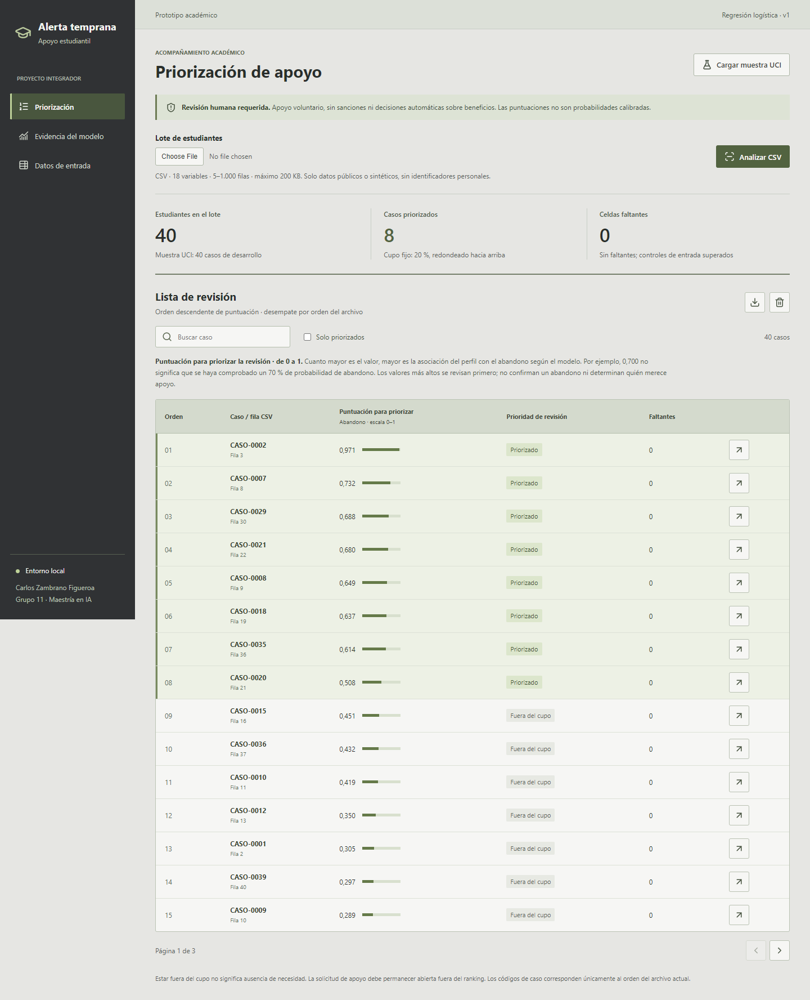
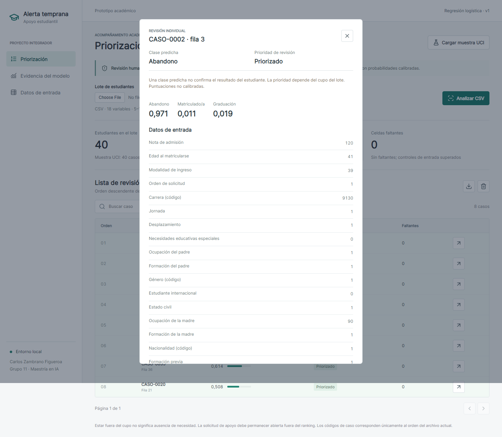
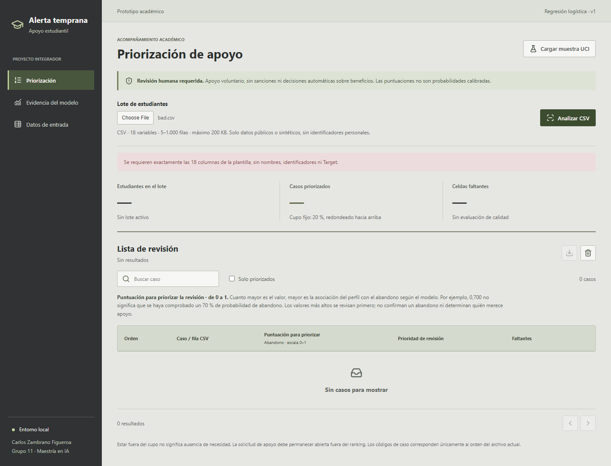
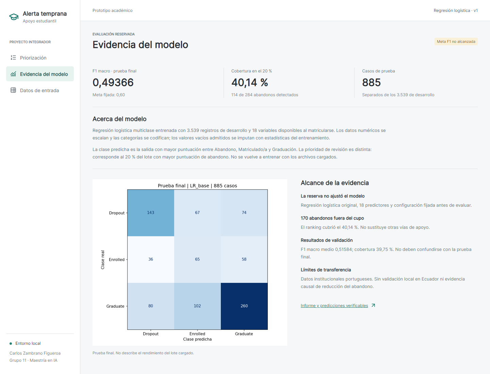

# Manual de la aplicacion local

## Uso previsto

Demostracion academica de priorizacion para revision humana y apoyo voluntario.
No usar con datos personales reales ni para sanciones, admisiones o asignacion
automatica de beneficios. El modelo no esta validado para una institucion local.

## Instalacion y arranque

Desde la raiz del repositorio, con Python 3.11:

```powershell
python -m venv .venv
.\.venv\Scripts\python.exe -m pip install -r requirements.txt
.\.venv\Scripts\python.exe -m src.finalize
.\.venv\Scripts\python.exe -m app.app --port 5057
```

Abrir http://127.0.0.1:5057. Para detener el proceso iniciado desde una terminal,
usar Ctrl+C. Si el puerto esta ocupado, elegir otro, por ejemplo --port 5058.
El servidor escucha exclusivamente en la interfaz local 127.0.0.1, sin debug.
No se necesita Node para usar la aplicacion. En macOS/Linux usar .venv/bin/python.

El servidor Flask incorporado es para demostracion local, no para publicacion
en Internet. No hay autenticacion, gestion institucional de permisos ni registro
persistente de intervenciones.

## Recorrido de demostracion

1. Al abrir, se analiza una muestra fija de 40 registros publicos de desarrollo:
   se priorizan 8. No son alumnos de Ecuador ni casos nuevos de prueba.
2. En Priorizacion, revisar los conteos superiores y la lista ordenada por
   puntuacion Dropout. El cupo es ceil(0,20*n), no un umbral de riesgo.
3. Activar Solo priorizados o buscar por codigo CASO. Estos filtros no recalculan
   el cupo. La paginacion muestra hasta 15 casos por pagina.
4. Abrir la flecha de un caso para ver las tres puntuaciones y las 18 entradas.
   El detalle distingue Clase predicha (la salida de mayor puntuacion) de
   Prioridad de revision (pertenencia al cupo del 20% del lote).
   Cerrar con la X o Escape. Las celdas vacias se identifican como imputadas;
   no se modifica manualmente el modelo.
5. Usar el icono de descarga para exportar **todo el lote**, no solo la pagina
   ni el filtro visible. Los resultados se descargan voluntariamente al equipo.
6. Vaciar el lote elimina sus resultados de la vista. Recargar la pagina vuelve
   a la muestra publica; la aplicacion no mantiene el archivo subido entre visitas.



En la captura: los tres conteos resumen el lote; las filas verdes pertenecen
al cupo; las flechas abren el detalle. La puntuacion es una salida del modelo
entre 0 y 1, **no una probabilidad calibrada**. Estar fuera del cupo no descarta
necesidad de apoyo; debe existir una via abierta de solicitud independiente.

## Preparacion y carga de CSV



La clase no es un diagnostico ni confirma el desenlace. El ranking y la clase
son salidas distintas: la primera depende del resto del lote y del cupo.

En Datos de entrada se puede descargar la plantilla de cabeceras o una muestra
publica completa para comprobar el flujo. La plantilla vacia no se puede analizar
hasta tener al menos cinco registros.

- Codificacion UTF-8 (con o sin BOM), separador coma o punto y coma.
- Decimales con punto. Entre 5 y 1.000 registros; hasta 200.000 bytes.
- Exactamente las 18 columnas mostradas en Datos de entrada. No agregar Target,
  nombres, correos, identificadores ni indicadores de rendimiento semestral.
- No repetir cabeceras ni incluir filas vacias o distinto numero de campos.
- Se aceptan celdas vacias; se rechaza superar el 20% por fila o por lote.
- Las categorias deben pertenecer a las observadas en desarrollo. La pantalla
  Datos de entrada muestra los codigos permitidos; no son cantidades ordinales.
- Notas entre 0 y 200, orden de solicitud entero 0-9 y edad entera 1-100.
  Los numericos fuera del rango observado en desarrollo producen advertencias
  aunque esten dentro de los limites formales. Las escalas deben revisarse.

Seleccionar el archivo y pulsar Analizar CSV. Ante un error se retiran los
resultados anteriores para no confundirlos con la nueva carga.
Los identificadores CASO se generan por posicion, no identifican personas.
Fila CSV se refiere al registro contado desde la cabecera; no al indice del
dataset original. La muestra no incluye sus etiquetas reales.



El mensaje rojo identifica el control fallido. No hay lista exportable hasta
que se analice un lote valido. Los mensajes de advertencia de imputacion o rango
no constituyen una garantia de validez.

## Evidencia del modelo

Acerca del modelo describe la regresion multiclase, sus 18 entradas y el
preprocesamiento. Distingue el entrenamiento inicial de la inferencia con
archivos nuevos, que no modifica el modelo.

La segunda seccion presenta la prueba final historica: F1 macro 0,49366,
cobertura 40,14%, 114 abandonos detectados de 284. Son resultados de 885 casos
de prueba, no metricas calculadas sobre el lote cargado. La aplicacion no conoce
el resultado real de los nuevos registros y no calcula su F1.



La meta F1 de 0,60 no se alcanza. La matriz distingue filas reales y columnas
predichas. La auditoria por subgrupos y las pruebas de robustez corresponden
a desarrollo y no autorizan uso institucional.

## Exportacion

El CSV de resultados contiene caso, fila de origen, orden, puntuacion de abandono,
priorizado (1/0), clase predicha y numero de celdas faltantes. La clase predicha
Dropout no equivale a pertenecer al cupo: son decisiones distintas. No incorpora
los atributos sensibles ni las 18 entradas al archivo de resultados.

## Privacidad y controles

La aplicacion procesa el CSV en memoria y no lo guarda como archivo del servidor.
El limite de la peticion evita superar el umbral normal de volcado temporal del
parser multipart. No se usa almacenamiento del navegador ni cookies para los lotes.
Los registros HTTP ordinarios contienen rutas y estados, no el contenido cargado.
La exportacion solicitada por el usuario si crea un archivo local.

Se restringen Host y origen de las solicitudes; se incluyen cabeceras CSP,
nosniff y proteccion contra incrustacion. Los recursos visuales y scripts se
sirven localmente. El enlace al informe abre GitHub solo al seleccionarlo.
Estos controles no equivalen a una auditoria de seguridad ni cumplimiento juridico.
Referencia de implementacion: [seguridad en Flask](https://flask.palletsprojects.com/en/stable/web-security/).

## Problemas frecuentes

| Situacion | Accion |
|---|---|
| No abre la pagina | Comprobar que el servidor sigue activo y que el puerto coincide |
| Falta Flask u otra dependencia | Instalar requirements.txt en el mismo Python que ejecuta el servidor |
| Esquema incorrecto | Comparar cabeceras con la plantilla; eliminar columnas adicionales |
| Codigo desconocido | No reemplazarlo arbitrariamente; revisar el diccionario y la pertinencia del lote |
| Datos faltantes excesivos | Completar la fuente; no rellenar con valores inventados |
| Modelo o dependencias no disponibles | Ejecutar python -m src.finalize y revisar versiones registradas |
| Tabla ancha en movil | Desplazar horizontalmente la tabla; el resto de la pagina se ajusta al ancho |

La validacion no detecta todos los errores de captura ni garantiza que dos
instituciones usen escalas equivalentes. La imputacion puede ocultar informacion
faltante relevante. No se incorpora un canal real de apelaciones ni notificaciones
a estudiantes; las salvaguardas institucionales descritas son propuestas.

## Verificacion

93 pruebas Python y un recorrido de navegador con Playwright comprueban muestra,
carga valida, rechazo de errores, concordancia con el modelo, filtros, paginacion,
detalle, descarga, evidencia y ausencia de desbordamiento de pagina en movil.

```text
python -m unittest discover -s tests
node tests/browser_app.cjs
```

El segundo comando requiere Playwright, Chrome y el servidor local activo.
Las dependencias de navegador se instalan con npm install desde la raiz
(package.json); npm run test:browser ejecuta el mismo recorrido.
Permite APP_URL y BROWSER_CHANNEL para cambiar direccion o navegador compatible.
Las capturas de este manual proceden de ese recorrido. Para incidencias tecnicas
del prototipo, registrar un issue en el repositorio sin adjuntar datos personales.

## Tres casos para la grabacion

Los archivos estan en [data/examples](../data/examples/README.md) y en los enlaces
de Casos de demostracion de Datos de entrada. Se reproducen con
`python -m src.demo_cases`.

| Caso | Resultado esperado | Evidencia en pantalla |
|---|---|---|
| Lote valido | 40 registros, 8 priorizados | Lista, detalle, clase y puntuaciones |
| Una nota vacia | Lote aceptado con 1 celda faltante | Advertencia de imputacion |
| Carrera invalida | Rechazo por codigo Course desconocido | Mensaje, lista vacia y exportacion deshabilitada |

La ausencia de nota y el codigo invalido fueron introducidos para la
demostracion. No son nuevos datos de evaluacion ni respaldan cambios en F1.
La grabacion debe mostrar resultados reales de la interfaz y no una simulacion.
