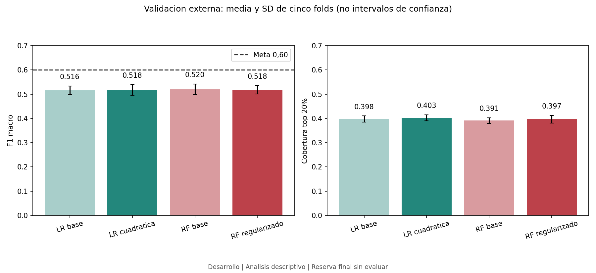
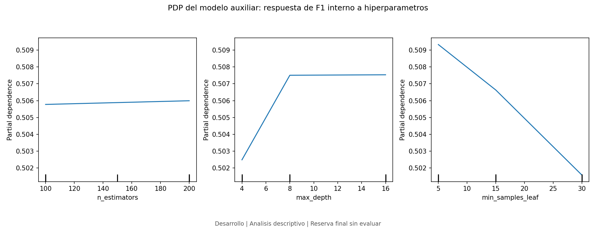
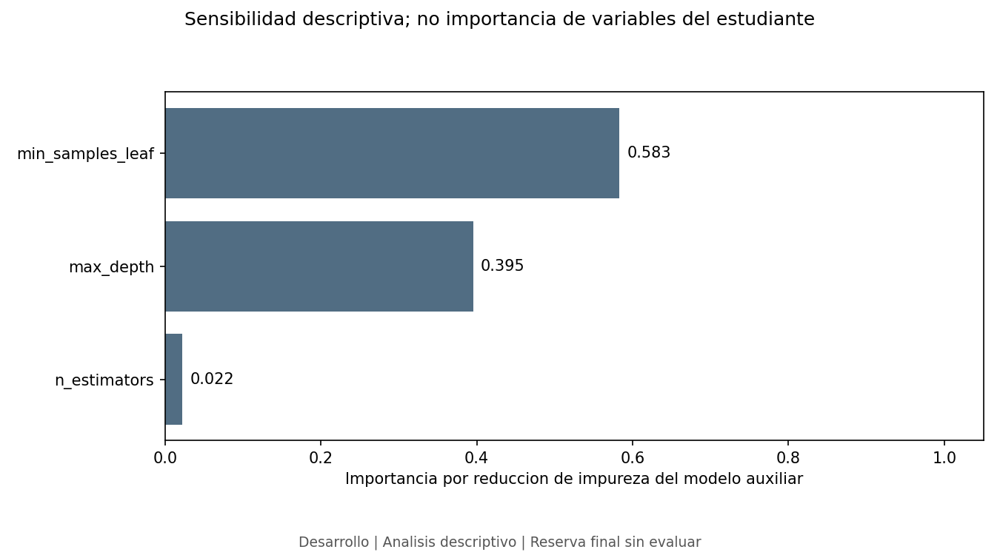
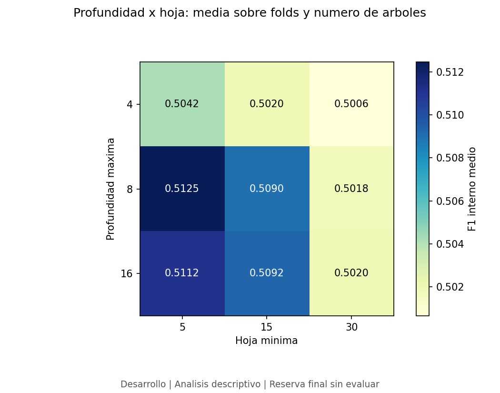
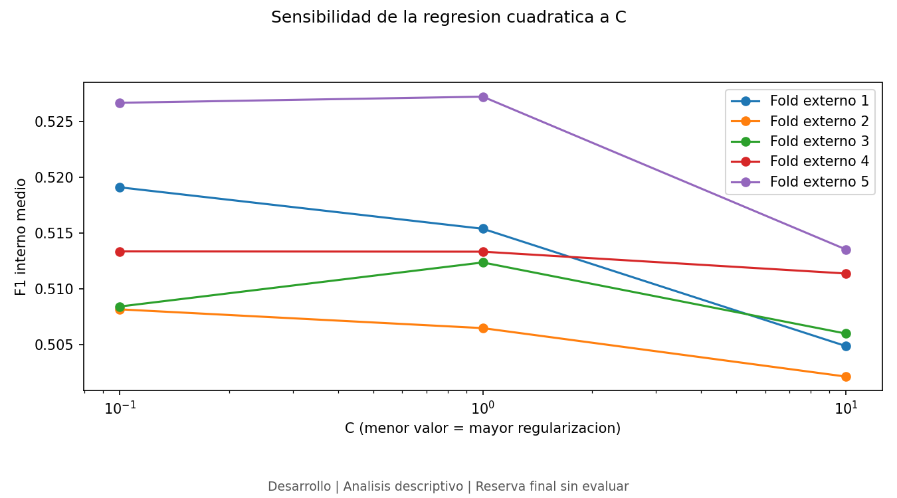

# Optimizacion y validacion

## Protocolo definido antes de ejecutar

Configuracion: [config/optimization.json](../config/optimization.json), version
2026-10-21-v1. Se conservan las 18 variables, los cinco folds historicos y la
reserva final de 885 filas. No se usan datos de la reserva en estos experimentos.

El diagnostico de referencia identifica sobreajuste en Random Forest y sesgo
alto o senal limitada en la regresion. Se comparan dos estrategias:

| Estrategia | Hipotesis | Configuraciones |
|---|---|---|
| RF regularizado | Limitar capacidad puede reducir la brecha de sobreajuste | 100/200 arboles; profundidad 4/8/16; hoja minima 5/15/30: 18 combinaciones |
| LR cuadratica | Relaciones no lineales e interacciones numericas pueden reducir el sesgo | Grado 2 en cuatro variables numericas; C=0,1/1/10: 3 combinaciones |

La expansion cuadratica conserva las cuatro variables numericas, agrega sus
cuadrados y seis interacciones (14 terminos). No multiplica codigos nominales.
La imputacion precede a la expansion y el escalado se ajusta despues. Las
categorias conservan one-hot sin agrupacion. Ambas estrategias usan ponderacion
balanced y semilla 42. LR conserva max_iter=3000 y se registran advertencias.

Dentro de cada fold externo se crean tres folds estratificados internos con
semilla 142 + numero de fold. Cada candidato se ajusta con todo su pipeline en
entrenamiento interno, sin reutilizar transformaciones aprendidas globalmente.

Seleccion interna: mayor F1 macro medio, luego mayor cobertura al 20% si hay
empate exacto. En un empate restante, RF prefiere menos arboles, menor profundidad
y mayor hoja minima; LR prefiere menor C. El ganador se reajusta con todo el
entrenamiento externo y se evalua una vez en su validacion externa.

Las medias externas se comparan con los modelos base sobre los mismos folds.
Se publican F1 de entrenamiento/validacion, brecha, cobertura y cambios por fold.
La desviacion estandar no es un intervalo de confianza y los folds no son
experimentos independientes. La comparacion de familias es exploratoria; la
configuracion final y la evaluacion de prueba se reservan para una fase posterior.

La sensibilidad se describira con resultados internos: curvas por parametro,
PDP de un modelo auxiliar del rendimiento, importancia de sus parametros e
interaccion profundidad-hoja. No se utilizaran resultados externos para volver
a elegir rangos en esta ejecucion. El modelo auxiliar no predice abandono.

El protocolo se registro antes de ejecutar; los resultados se presentan a continuacion. Las pruebas de estres,
calibracion, equidad, seleccion definitiva y evaluacion de reserva no forman
parte de esta ejecucion y siguen pendientes.

## Resultados ejecutados

Se completaron 105 evaluaciones de configuraciones (21 por fold externo),
315 ajustes internos y 10 reajustes externos. Se verificaron 7.078 predicciones
OOF, seleccion interna y pertenencia a particiones. Advertencias registradas:
0. [Resultados y registros](../results/metrics/optimization_results.json).

| Modelo/estrategia | F1 entrenamiento | F1 validacion | SD validacion | Brecha | Cobertura 20% |
|---|---:|---:|---:|---:|---:|
| LR_base | 0.57485 | 0.51584 | 0.01836 | 0.05902 | 39.75% |
| LR_quadratic | 0.56930 | 0.51777 | 0.02220 | 0.05152 | 40.28% |
| RF_base | 0.78057 | 0.51996 | 0.02241 | 0.26061 | 39.14% |
| RF_regularized | 0.61684 | 0.51792 | 0.01780 | 0.09892 | 39.67% |

Cada estrategia puede elegir configuraciones distintas por fold. Su promedio
evalua un procedimiento de ajuste, no un unico modelo final entrenado.

| Estrategia frente a su base | Cambio F1 | Cambio cobertura | Folds con mayor F1 |
|---|---:|---:|---:|
| LR_quadratic | +0.00193 | +0.53 pp | 3/5 |
| RF_regularized | -0.00204 | +0.53 pp | 3/5 |

La brecha de RF pasa de 0.26061 a 0.09892.
La de LR pasa de 0.05902 a 0.05152.
Reducir una brecha no basta para afirmar mejora: debe considerarse tambien el
F1 externo y la cobertura. La expansion cuadratica es una intervencion sobre
la representacion, no simplemente mas regularizacion de la regresion base.
Los cambios por fold se conservan en [la evidencia de sensibilidad](../results/metrics/optimization_sensitivity.json).

En esta ejecucion, RF reduce su sobreajuste pero su F1 externo cae ligeramente
frente a la base. La regresion cuadratica mejora apenas y no resuelve el
rendimiento limitado. Ambas aumentan la cobertura unos 0,53 puntos porcentuales,
pero ninguna alcanza la meta F1 de 0,60. No se justifica presentar estas
estrategias como una mejora concluyente ni declarar un ganador definitivo.

## Configuraciones elegidas por validacion interna

| Fold externo | Estrategia | Parametros elegidos |
|---|---|---|
| 1 | RF_regularized | {"max_depth": 16, "min_samples_leaf": 5, "n_estimators": 100} |
| 1 | LR_quadratic | {"C": 0.1} |
| 2 | RF_regularized | {"max_depth": 8, "min_samples_leaf": 5, "n_estimators": 200} |
| 2 | LR_quadratic | {"C": 0.1} |
| 3 | RF_regularized | {"max_depth": 16, "min_samples_leaf": 5, "n_estimators": 200} |
| 3 | LR_quadratic | {"C": 1.0} |
| 4 | RF_regularized | {"max_depth": 8, "min_samples_leaf": 15, "n_estimators": 100} |
| 4 | LR_quadratic | {"C": 0.1} |
| 5 | RF_regularized | {"max_depth": 8, "min_samples_leaf": 5, "n_estimators": 200} |
| 5 | LR_quadratic | {"C": 1.0} |

Si un ganador esta en un extremo del rango explorado, no se afirma que sea un
optimo global. No se ampliaron los rangos despues de observar la validacion
externa. Aun falta fijar una familia y ajustar su configuracion de produccion
sobre desarrollo con un protocolo documentado; no hay modelo final guardado.

## Sensibilidad y dependencia parcial

Para RF se promedian los F1 internos de cada configuracion sobre los cinco
entrenamientos externos. Un RandomForestRegressor auxiliar de 300 arboles,
semilla 42, aproxima esa superficie de 18 puntos. Su R2 sobre esos mismos
puntos es 0.9862: mide fidelidad de ajuste, no generalizacion ni rendimiento
del clasificador.

Los PDP promedian la respuesta predicha al variar un hiperparametro y mantener
la distribucion de los otros. La importancia por reduccion de impureza del
auxiliar situa el mayor peso en **min_samples_leaf** (0.583).
Este ranking es descriptivo, depende del rango y del modelo auxiliar y no tiene
intervalos de confianza. No corresponde a importancia de variables del alumnado.

El mapa profundidad-hoja usa directamente F1 internos observados y promedia
sobre numero de arboles y folds. Permite examinar combinaciones; no es una prueba
formal de interaccion. Las curvas de LR muestran la respuesta interna a C con
la representacion cuadratica fijada.











## Limites y siguientes comprobaciones

El mayor F1 externo observado entre estas dos estrategias es
0.51792.
La meta sigue siendo 0,60 y solo se declarara alcanzada si la evidencia lo
respalda. No se interpreta una diferencia pequena como significacion estadistica.
Los folds comparten datos de entrenamiento y la eleccion posterior de familia
usa desarrollo; la estimacion confirmatoria requerira el protocolo final.

Persisten pendientes las pruebas de estres con tolerancias previas, fairness
por subgrupos, calibracion, seleccion definitiva y evaluacion de la reserva.
No se han usado datos de prueba para elegir configuraciones.

## Reproduccion

```text
python -m src.optimize
python -c "from src.optimize import verify; print(verify())"
python -m src.optimization_report
```

El notebook 04 permite leer y verificar los resultados guardados, o repetir
la busqueda explicitamente. Este reporte se genera a partir de los JSON.
