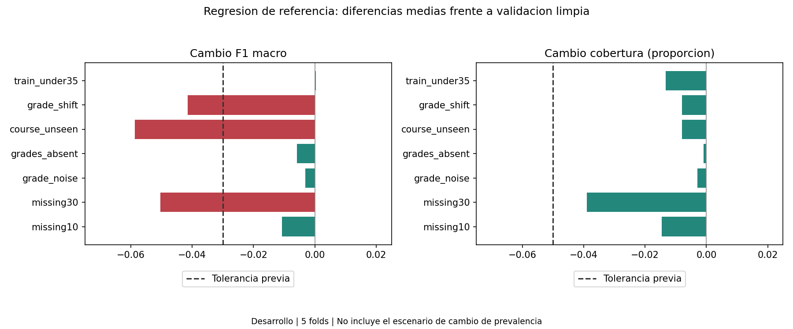

# Robustez de la regresion de referencia

## Protocolo previo a la ejecucion

Se conserva LR_base, las 18 variables y los cinco folds historicos de desarrollo.
Las 885 filas de prueba no intervienen. Se utiliza el mismo modelo de referencia
que en la auditoria por subgrupos, sin elegir parametros con estos resultados.

Tolerancias exploratorias: caida absoluta de F1 macro no mayor de 0,03 y de
cobertura al 20% no mayor de 0,05 respecto al escenario limpio comparable.
Ambos limites deben cumplirse. Son criterios de este experimento, no requisitos
institucionales validados ni pruebas de significacion. No se ajustaran despues
de observar resultados. Se reportaran medias y peores diferencias por fold.

| Escenario | Intervencion |
|---|---|
| clean | Validacion original; reproduce la referencia historica |
| missing10 | Ocultar al azar el 10% esperado de celdas predictoras |
| missing30 | Ocultar al azar el 30% esperado de celdas predictoras |
| grade_noise | Ruido normal en las dos notas, SD=0,2 por SD del entrenamiento; recorte a 0-200 |
| grades_absent | Ausencia completa de ambas notas en validacion |
| course_unseen | Sustituir Course por un codigo sintetico ausente del entrenamiento |
| grade_shift | Restar 20 puntos a ambas notas de validacion, con recorte a 0-200 |
| dropout50 | Submuestra con todos los Dropout y igual numero de otros casos, sin reemplazo |
| train_under35 | Reentrenar exclusivamente con menores de 35 del entrenamiento; validar en el fold original |

missing10, missing30, grade_noise y dropout50 usan tres semillas (71, 172, 273)
sumadas al numero de fold. Los demas escenarios son deterministas. Primero se
promedian repeticiones dentro de fold y luego los cinco folds con igual peso.
Las repeticiones no son nuevas muestras independientes.

Salvo train_under35, el pipeline se ajusta una vez por fold y se congela antes
de alterar la validacion. La imputacion, escalado y categorias no se reajustan.
train_under35 es un experimento de cambio de composicion del entrenamiento,
separado de la perturbacion de entradas. No equivale a una validacion temporal.

dropout50 cambia composicion y prevalencia de la evaluacion: su diferencia con
clean no aisla deterioro del clasificador. Las tolerancias se marcaran como
no aplicables en ese escenario; se reportan metricas y conteos descriptivos.
Los errores se calculan con las etiquetas originales, nunca modificadas.
Ninguna perturbacion simula completamente otra universidad o Ecuador.

## Resultados

| Escenario | F1 macro | Cobertura 20% | Cambio F1 | Cambio cobertura | Tolerancia media | Todos los folds |
|---|---:|---:|---:|---:|---|---|
| clean | 0.51584 | 39.75% | +0.00000 | +0.00 pp | No aplica | No aplica |
| missing10 | 0.50510 | 38.29% | -0.01074 | -1.46 pp | Dentro | Dentro |
| missing30 | 0.46545 | 35.85% | -0.05039 | -3.90 pp | Fuera | Fuera |
| grade_noise | 0.51272 | 39.46% | -0.00312 | -0.29 pp | Dentro | Dentro |
| grades_absent | 0.50997 | 39.66% | -0.00587 | -0.09 pp | Dentro | Dentro |
| course_unseen | 0.45720 | 38.96% | -0.05864 | -0.79 pp | Fuera | Fuera |
| grade_shift | 0.47435 | 38.96% | -0.04149 | -0.79 pp | Fuera | Fuera |
| dropout50 | 0.50558 | 32.54% | -0.01026 | -7.21 pp | No aplica | No aplica |
| train_under35 | 0.51617 | 38.43% | +0.00033 | -1.32 pp | Dentro | Dentro |

### Peor diferencia entre los cinco folds

Primero se promedian las repeticiones de cada fold. Los peores cambios de F1 y
cobertura pueden corresponder a folds diferentes.

| Escenario | Peor cambio F1 | Peor cambio cobertura |
|---|---:|---:|
| clean | +0.00000 | +0.00 pp |
| missing10 | -0.02937 | -3.07 pp |
| missing30 | -0.06863 | -5.12 pp |
| grade_noise | -0.00528 | -0.44 pp |
| grades_absent | -0.01582 | -0.88 pp |
| course_unseen | -0.07630 | -1.76 pp |
| grade_shift | -0.05053 | -1.76 pp |
| dropout50 | -0.01682 | -8.63 pp |
| train_under35 | -0.01658 | -3.52 pp |

### Interpretacion y controles derivados

missing30, course_unseen y grade_shift exceden la tolerancia media de F1.
Aceptar entradas sin fallos de software no equivale a mantener rendimiento:
one-hot admite carreras desconocidas, pero el clasificador pierde informacion.

La interfaz debera advertir sobre categorias no vistas y ausencia extensa de
datos; las escalas de notas deben verificarse antes de inferir. Un valor dentro
de 0-200 puede seguir perteneciendo a otra escala o distribucion: los controles
de rango por si solos no detectan el desplazamiento sistematico ensayado.
Estos controles son recomendaciones derivadas del experimento, no funcionalidades
ya implementadas.

La ausencia conjunta de notas produce poca caida media en este ensayo. Esto
no prueba que las notas carezcan de informacion: hay otras variables y la
imputacion conserva estadisticas del entrenamiento original.
train_under35 queda dentro de tolerancia global, pero eso no garantiza buen
rendimiento en mayores de 34; requeriria una auditoria especifica de ese modelo.

Las diferencias se comparan con clean. En dropout50, cambia la poblacion
evaluada: no se interpreta su diferencia como perdida atribuible a una
perturbacion de variables. Una media dentro de tolerancia no significa que
todos los folds la cumplan. Pasar estas pruebas no certifica robustez universal.

El escenario train_under35 reajusta el pipeline con un subconjunto del
entrenamiento; todos los demas conservan el modelo fijo. Se comprobo que
predecir no cambia su estado serializado. clean reproduce las probabilidades
historicas de LR_base. La reserva no se evalua y las cifras no son prueba final.

## Evidencia y reproduccion

Ejecutar `python -m src.stress`. Para auditar resultados guardados:
`python -c "from src.stress import verify; print(verify())"`.

[Resultados por fold y repeticion](../results/metrics/stress_results.json).
[Predicciones auditables](../results/metrics/stress_predictions.csv).
Las semillas controlan las perturbaciones; los conteos reales de celdas
ausentes y clases se registran por experimento. Las etiquetas no se alteran.
