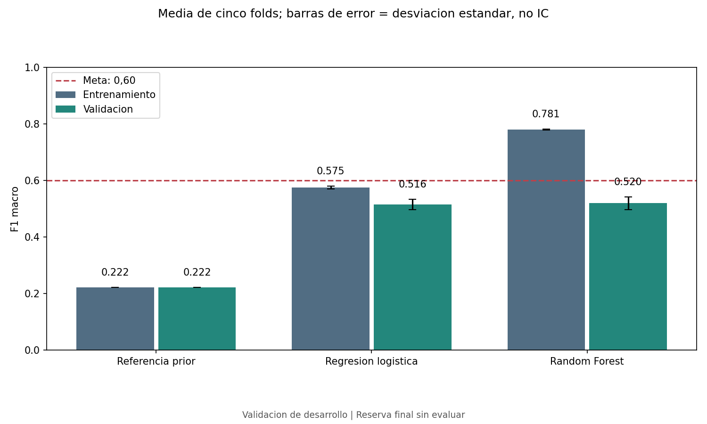
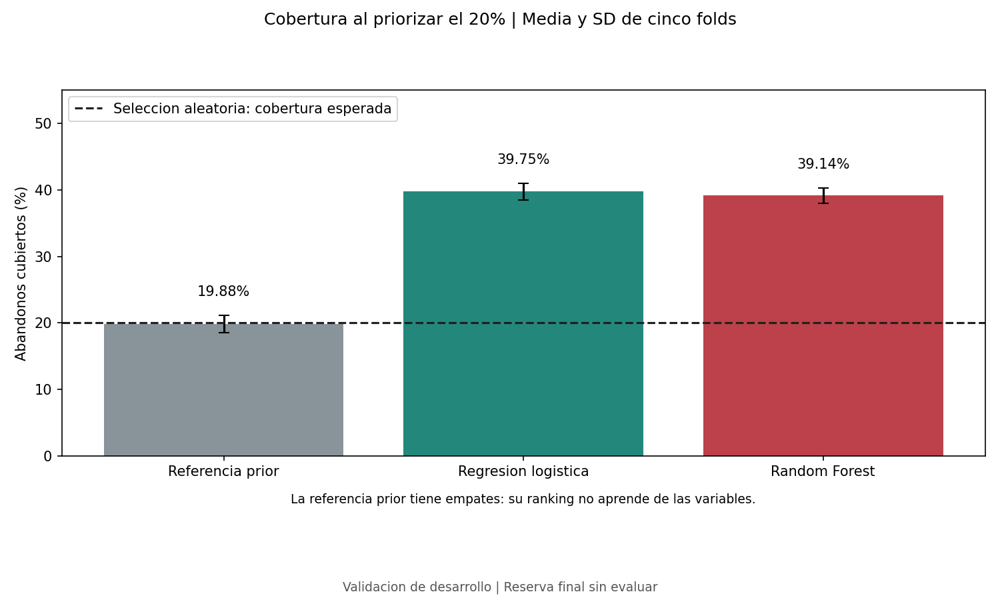
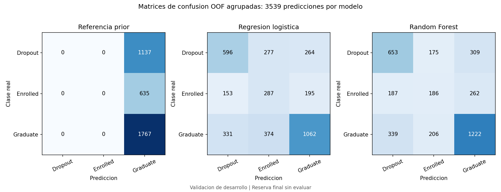

# Comparacion de modelos base

## Protocolo

Se entrenan tres pipelines independientes en los cinco folds historicos de las
3.539 filas de desarrollo. Imputacion, escalado y codificacion se ajustan solo
con entrenamiento. No se seleccionan hiperparametros en esta fase. La reserva
de 885 filas sigue sin evaluarse.

La regresion logistica usa C=1, ponderacion balanced, max_iter=3000 y semilla 42.
Random Forest usa 200 arboles, min_samples_leaf=3, max_depth=None,
max_features=sqrt, ponderacion balanced y semilla 42. La referencia Dummy prior
devuelve las frecuencias de clase de entrenamiento y predice la clase mayoritaria.

Los parametros completos, versiones y advertencias estan en
[baseline_results.json](../metrics/baseline_results.json).
Las predicciones fuera de fold estan en
[baseline_predictions.csv](../metrics/baseline_predictions.csv), en el orden
historico de desarrollo. No contienen nombres ni identificadores personales;
row_index es una posicion del dataset publico.

## Resultados de validacion

| Modelo | F1 entrenamiento | F1 validacion | SD del F1 validacion | Brecha F1 | Cobertura top 20% |
|---|---:|---:|---:|---:|---:|
| Referencia prior | 0.22201 | 0.22201 | 0.00021 | 0.00000 | 19.88% |
| Regresion logistica | 0.57485 | 0.51584 | 0.01836 | 0.05902 | 39.75% |
| Random Forest | 0.78057 | 0.51996 | 0.02241 | 0.26061 | 39.14% |

Las cifras son medias no ponderadas de cinco folds. La SD describe variacion,
no un intervalo de confianza ni una prueba de significacion. Las matrices de
confusion y el classification_report se calculan sobre las predicciones OOF
agrupadas; su F1 no debe sustituir silenciosamente la media de folds.

## Definicion de cobertura

En cada fold se seleccionan ceil(0,20*n) filas con mayor puntuacion Dropout.
Cobertura = abandonos seleccionados / abandonos reales. No equivale a precision,
accuracy ni recall multiclase. Los empates se resuelven de forma estable usando
el orden historico; el archivo registra selected_top20 para auditar la lista.

La referencia prior asigna la misma puntuacion a todos los estudiantes del fold.
Su ranking depende del desempate, no de capacidad predictiva. Se compara ademas
con una seleccion uniforme aleatoria de igual tamano, cuya cobertura esperada
es k/n: **20.0622%** en promedio, ligeramente mayor al 20% por el redondeo.
Esto es una expectativa matematica, no el resultado de una simulacion.

La regresion cubre **39.7527%** de los abandonos, aproximadamente
**1.98 veces** la cobertura aleatoria esperada. Aun deja
fuera alrededor de **60.25%** de los abandonos.
Esto no demuestra reduccion del abandono ni utilidad institucional validada.

## Diagnostico y decisiones

La regresion presenta rendimiento limitado incluso en entrenamiento
(F1 0.57485) y una brecha menor (0.05902).
Es consistente con sesgo alto o senal limitada bajo esta representacion;
no debe tratarse principalmente como un problema de sobreajuste.

Random Forest tiene una brecha de **0.26061**, consistente con sobreajuste.
La siguiente fase debe evaluar profundidad y tamano minimo de hojas, y explorar
representaciones o modelos no lineales regularizados para la limitacion de la
regresion. Todos los ajustes se elegiran dentro del entrenamiento.

Ninguno alcanza la meta F1 macro de 0,60. La pequena ventaja de Random Forest en
F1 no basta para declararlo superior: su cobertura es menor y falta cuantificar
la incertidumbre de la diferencia con un procedimiento adecuado.

Estas son configuraciones de referencia, no una seleccion final. No se
persisten modelos definitivos ni se usan resultados de prueba para decidir.
Fairness, calibracion y validacion externa siguen pendientes.

## Figuras







## Reproduccion

Desde la raiz del repositorio:

```text
python -m src.train
python -m src.verify
python -m src.baseline_report
```

La verificacion recalcula metricas de validacion desde las predicciones
serializadas, revisa pertenencia a folds, orden, cobertura y reportes agrupados.
Las medias y desviaciones de entrenamiento se contrastan con los registros
por fold; para verificar nuevamente sus predicciones hay que reentrenar.
Los tiempos de ejecucion pueden variar sin implicar diferencias de rendimiento.
